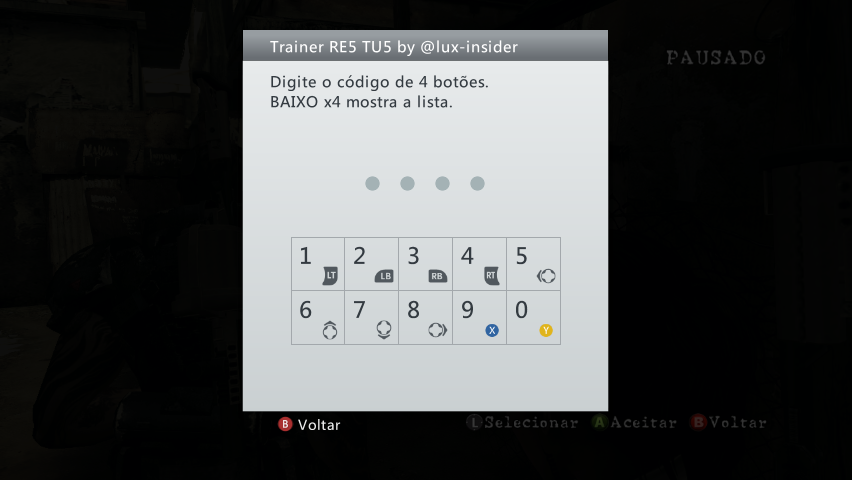
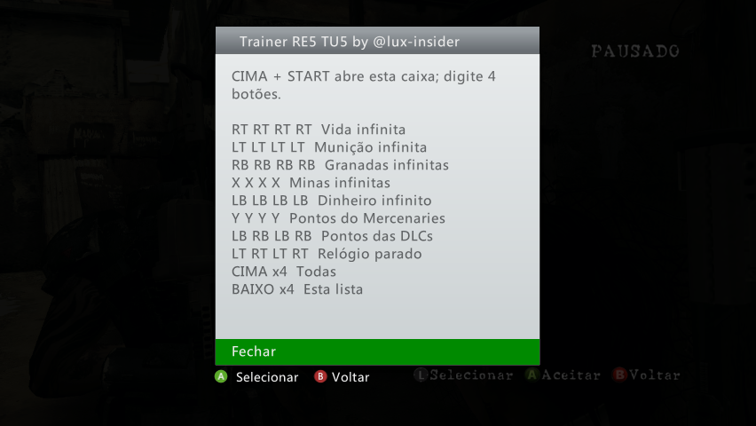
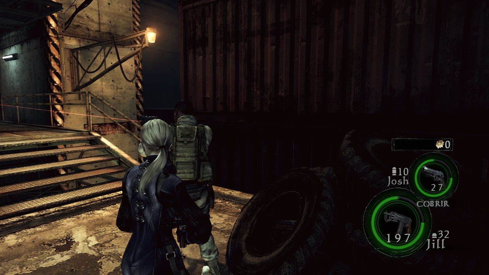

# Trainer RE5 TU5

Trainer para o **Resident Evil 5** de **Xbox 360** com a **Title Update 5
(TU5)**, para console desbloqueado (RGH/JTAG). Escrito do zero, com
conferências antes de qualquer gravação: ele confirma o jogo aberto e cada
instrução que vai alterar, para não travar o jogo.

---

## Sumário

- [Trapaças](#trapaças)
- [Capturas de tela](#capturas-de-tela)
- [Requisitos](#requisitos)
- [Instalação e uso](#instalação-e-uso)
- [Segurança](#segurança)
- [Problemas e sugestões](#problemas-e-sugestões)
- [Licença](#licença)

---

## Trapaças

Durante a partida, segure **CIMA (direcional) + START** por 1 a 2 segundos.
Aparece o aviso "Trainer RE5: abrindo..." e uma caixa para digitar um código
de 4 botões.

| Código | Trapaça |
|---|---|
| RT RT RT RT | Vida infinita |
| LT LT LT LT | Munição infinita |
| RB RB RB RB | Granadas infinitas |
| X X X X | Minas infinitas |
| LB LB LB LB | Dinheiro infinito |
| Y Y Y Y | Pontos do Mercenaries |
| LB RB LB RB | Pontos das DLCs |
| LT RT LT RT | Relógio parado |
| CIMA ×4 | Liga ou desliga todas |
| BAIXO ×4 | Lista dos códigos, com as que estão ligadas |

O mesmo código liga e desliga. A confirmação aparece no canto da tela
("...: LIGADA" ou "DESLIGADA") e no controle: **uma vibração longa = ligada**,
**duas curtas = desligada**. **B** fecha a caixa sem fazer nada.

---

## Capturas de tela

No console, com o jogo pausado:

| Caixa do código | Lista dos códigos (BAIXO ×4) |
|---|---|
|  |  |

*O trainer também funciona nas DLCs: aqui, rodando na Fuga Desesperada
(Desperate Escape), com a Jill e o Josh.*

---

## Requisitos

| Item | Detalhe |
|---|---|
| Console | Xbox 360 desbloqueado (RGH/JTAG) com DashLaunch |
| Jogo | Resident Evil 5 com a **TU5** (Title ID `434307D4`) |
| Avisos na tela | plugin **JRPC2** carregado pelo DashLaunch (opcional: sem ele, a vibração indica o estado) |

---

## Instalação e uso

1. Baixe o `.zip` da página de
   [**Releases**](https://github.com/lux-insider/trainer-re5-tu5/releases/latest)
   e copie os dois arquivos para a mesma pasta no console, por exemplo
   `Usb:\Apps\RE5 Trainer TU5\` ou `Hdd1:\Trainers\RE5\`:

   | Arquivo | Função |
   |---|---|
   | `RE5 Trainer Loader.xex` | abre pelo Aurora e carrega o trainer |
   | `re5trainer.xex` | o trainer |

2. No Aurora, abra o `RE5 Trainer Loader.xex`, por exemplo pelo gerenciador
   de arquivos. Aparece "Trainer RE5 TU5 by @lux-insider carregado" e o
   console volta ao Aurora.
3. Abra o Resident Evil 5 sem desligar o console. Ao entrar no jogo aparece
   "Trainer RE5 by @lux-insider ativo".
4. Na partida, use **CIMA + START** e digite o código.

O trainer fica na memória até o console ser desligado. Para trocar por uma
versão nova, desligue o console da tomada antes de abrir o loader de novo.

---

## Segurança

- **Só age no Resident Evil 5.** No Aurora ou em outro jogo, CIMA + START não
  faz nada.
- **Confere a versão do jogo:** antes de gravar, verifica que as 12
  instruções alteradas estão exatamente como na TU5. Se uma não bater, não
  grava nada e avisa.
- **Estado sempre correto:** cada trapaça é lida da própria memória do jogo,
  então nunca fica invertida.
- **Gravação conferida:** cada gravação é lida de volta; se falhar, a trapaça
  volta ao original.
- **Gravação protegida:** se a memória recusar a gravação, o trainer avisa em
  vez de derrubar o jogo.
- **Escopo mínimo:** não mexe em arquivos, saves, rede, NAND nem kv.bin.

---

## Problemas e sugestões

Erros e ideias são bem-vindos nas [issues](https://github.com/lux-insider/trainer-re5-tu5/issues/new/choose),
com um modelo para cada caso. Para falhas de segurança, veja o
[SECURITY.md](SECURITY.md).

---

## Licença

Programa **gratuito (freeware)**, de código fechado: pode usar à vontade, mas
não pode vender, republicar em outros sites nem modificar. Os termos completos
estão no [LICENSE](LICENSE).

*Resident Evil 5* / *BIOHAZARD 5* © CAPCOM CO., LTD. Projeto de fã, gratuito
e sem fins lucrativos, sem ligação com a Capcom ou a Microsoft.
